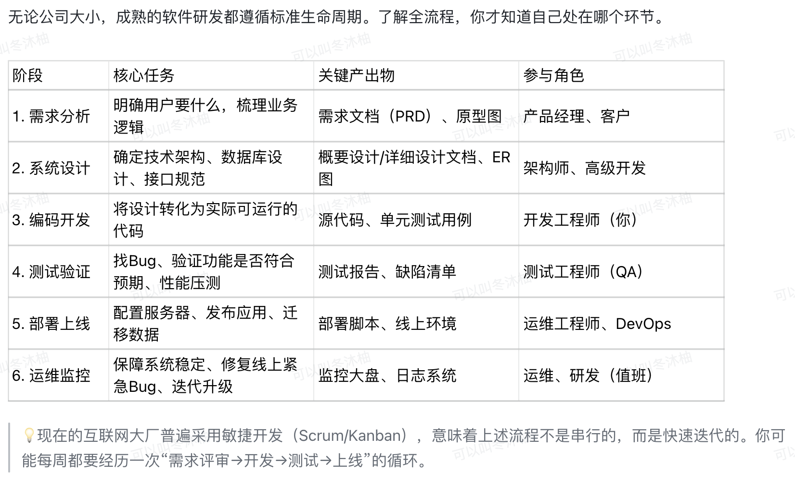
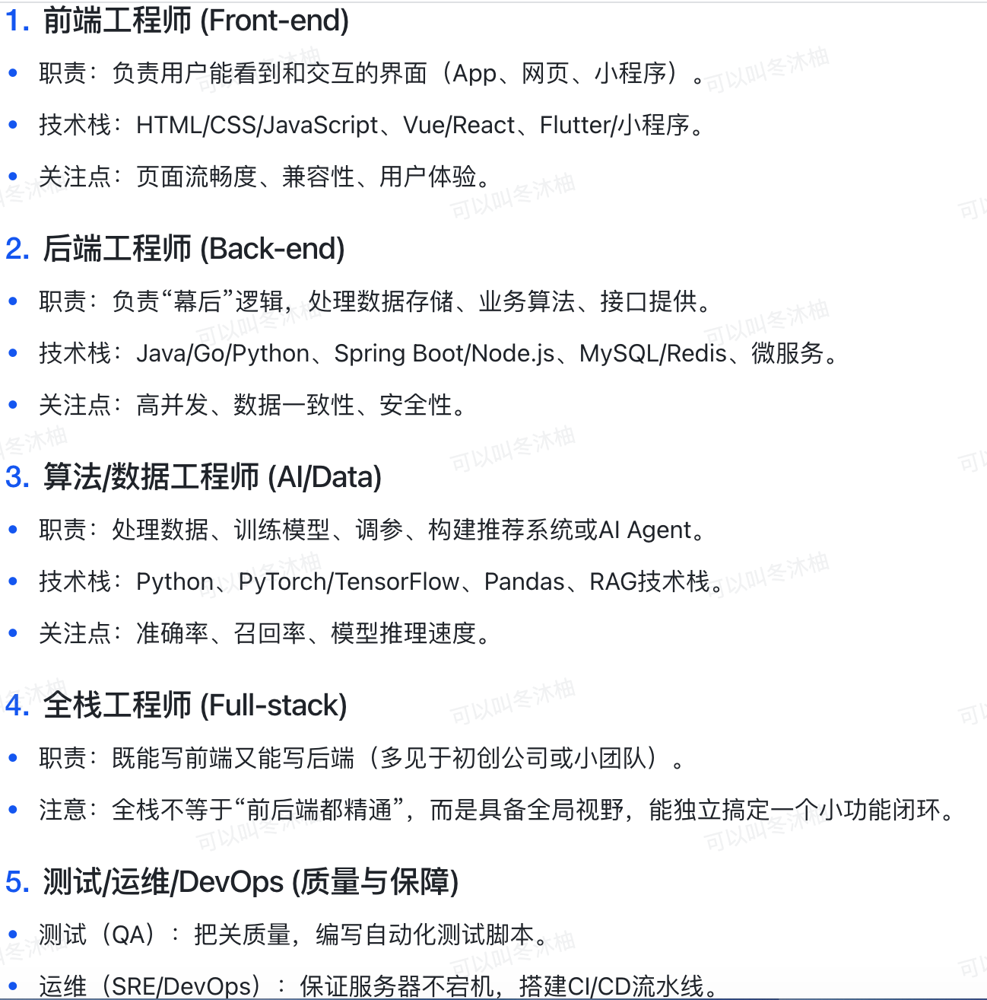
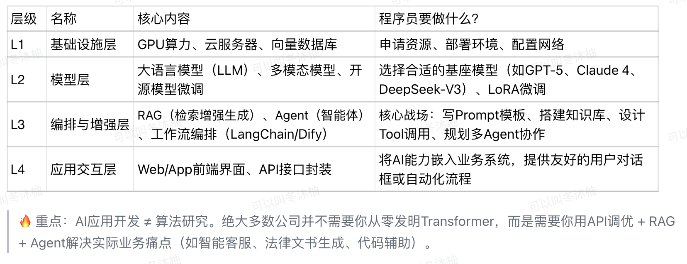
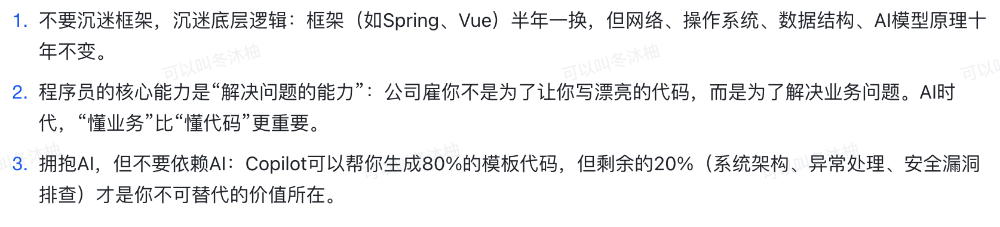

# day1-程序员的认知

### 程序员的认知
#### 一、什么是程序员？重新定义你的角色

> 在很多外行人眼里，程序员是“修电脑的”或“写英文单词的”。但在数字化浪潮与A爆发的今天，程序员是“数字世界
的建筑师”。
程序员的核心价值不在于敲键盘的速度，而在于将复杂的现实业务需求，翻译成计算机能理解的高效、稳定、可扩展的代码逻辑。尤其是在2026年，程序员已不再是单纯的“代码搬运工”，而是Al能力的调度者与业务落地的操盘手。

#### 二、核心认知：标准软件开发流程（SDLC）

#### 三、岗位分工图谱:你在哪一级?
> 软件开发不是一个人的战斗，了解兄弟岗位的职责，有助于你更好地协作。

#### 四、新时代必修课:AI应用开发组成（2026）
2026年，纯粹的CRUD(增删改查)工程师竞争力在下降。AI应用开发已成为高级程序员的必备技能。

> 一个标准的AI应用开发由以下四层组成:

#### 五、写在最后:给新人的三点“认知破局”

