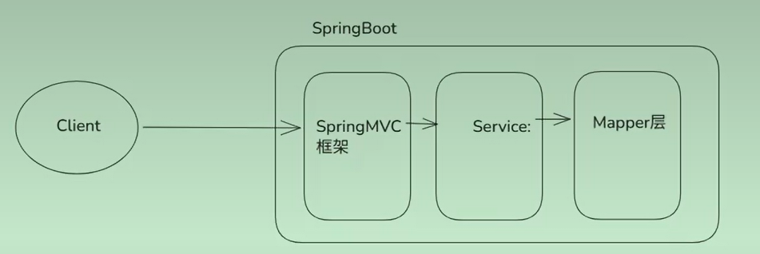

# day2-00Java语言

java基础: 基础语法，标识符，条件语句 循环语句，函数，方法... 所有语言都有的东西.表现形式不同.

java进阶：java核心面向对象.封装，继承，多态...API
集合/多线程/反射/注解/枚举...
面向对象的思维.
最重要：集合+Stream流 ArrayList（线性），HashMap（键值对），ConcurrentHashMap（考虑到安全问题），LinedArrayList，LindedHashMap...（其实传统java开发就是用集合+Stream流在对一系列实体操作，实体有很多，各种各样的实体）

框架： Tomcat web服务器：web项目都运行在web服务器.
Http协议
SpringBoot框架.一系列框架集成（把一系列模板式的配置代码都进行了封装，我们使用的时候就相当于定义了一个springboot的脚手架，可以直接去使用这些框架发挥他们在各个层的作用）

SpringMVC： spring家族的产品.应用controller层，接受参数，响应数据
文件上传
全局异常处理器：
拦截器

Spring框架：应用在三层，Service层应用有：@Transational
应用在各个层：控制事务.AOP，通知类型，IOC DI，注入

Mybatis/Mybatis-Plus：定义CRUD

微服务：（mq和seata是比较重要的，难点）
服务的拆分：服务独立运行，有自己独立的数据库，颗粒度不能太大，也不能太小
组件：
openFeign 远程调用工具
gateway. 一定有
nacos：注册中心，配置中心.
sentinel:限流，熔断，降级

mq：roctetMQ（所有MQ中处理高并发最强的，原理都是一样的不用太纠结）：很重要
git：版本管理工具.重要.(git 在idea 当中的使用) 重要重要~
linux：各种命令.
redis:基础，开发用到. setnx , set,get. 面试相关：（面试高频）雪崩/击穿/淘汰策略/删除策略...(但是跟开发没多大关系)
docker：简化linux操作.

seata:分布式事务.[深入] 很重要

shiro：主要是感受他的一些思想 security： 权限校验框架

八股文：Redis/MQ/MySQL/JVM/集合/JUC
面试高频：MQ/MySQL/
非重点：JVM JUC

AI项目：
(1)AI编程：看懂流程. AI方案~ 你审核，AI写代码.
(2)AI架子.引用AI，给项目赋能.
