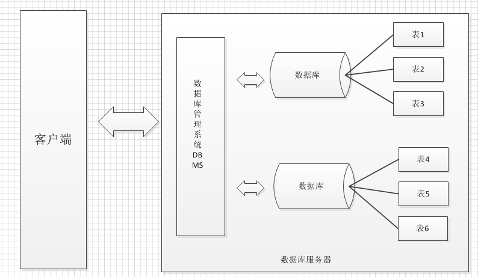
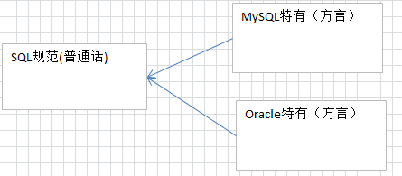
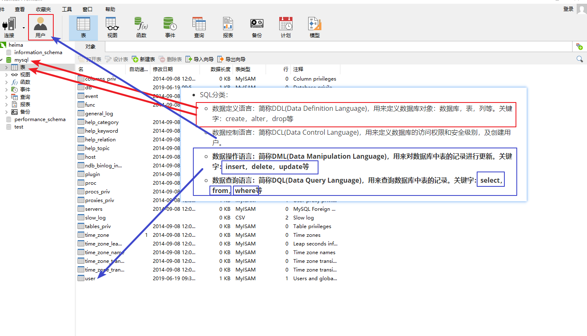

# day3-00MySQL基础&约束

## 一、什么是数据库

数据库就是存储数据的仓库，其本质是一个文件系统，数据按照特定的格式将数据存储起来。用户可以对数据库中的数据进行增加，修改，删除及查询操作。

```markdown
集合、文件、数据库，三者进行存储数据的对比：
1. 集合：数据存储在内存中；问题是，一旦程序执行完毕了，数据消失了，数据不能永久性的储存
2. 文件：数据储存在磁盘中，可以永久性储存；问题是，当文件储存数据量达到几个G时，文件的打开都成文件，数据的操作就更成问题了
3. 数据库：数据储存的磁盘中，可以永久性储存；当数据量很大时，数据操作起来也很流畅；合适数据的频繁的增删改查的操作
```

## 二、什么是数据库管理系统
数据库管理系统（DataBase Management System，DBMS）：指一种**操作数据库、管理数据库的大型软件**。

作用：**用于数据库的建立、使用和维护数据库**。

```markdown
注意：
1. 用户必须通过数据库管理系统才能访问到数据库中表的数据
2. 数据库中的表，是存储数据的基本单位
```

数据库管理系统的功能：**实现了对多个数据库进行统一管理和控制，以保证数据库的安全性和完整性**

- 数据库与数据库管理系统的内部结构



## 三、常用数据库：MYSQL（安装、本地连接、远程连接）
MySQL图形化开发工具：navicat

## 四、SQL语句

### 4.1、什么是SQL语句

数据库是不认识JAVA语言的，但是我们同样要与数据库交互，这时需要使用到数据库认识的语言【SQL语句】，它是数据库的代码。
结构化查询语言(Structured Query Language)简称SQL，是关系型数据库管理系统都需要遵循的规范。不同的数据库生产厂商都支持SQL语句，但都有特有内容。


### 4.2、深入了解SQL语句（四大类SQL语句）
- SQL分类：
  - 数据定义语言：简称DDL(Data Definition Language)，用来定义数据库对象：数据库，表，列等。关键字：create，alter，drop等 
  - 数据控制语言：简称DCL(Data Control Language)，用来定义数据库的访问权限和安全级别，及创建用户。
  - **数据操作语言：简称DML(Data Manipulation Language)，用来对数据库中表的记录进行更新。关键字：insert，delete，update等**
  - **数据查询语言：简称DQL(Data Query Language)，用来查询数据库中表的记录。关键字：select，from，where等**



### 4.3、SQL语句的表现形式

#### 4.3.1、SQL语句的书写语法

- MySQL数据库的SQL语句不区分大小写，关键字建议使用大写，以分号结尾。例如：

  ```mysql
  SELECT * FROM user;
  ```

- 使用/**/、 -- 、# 的方式完成注释

  ```mysql
  /*
  多行注释
  */
  # 单行注释
  SELECT * FROM user;
  ```

#### 4.3.2、SQL中数据的常用数据类型

- MySQL中的我们常使用的数据类型如下

| **类型名称 **    | 说明                                                   |
| ---------------- | ------------------------------------------------------ |
| **int**          | 整数类型                                               |
| **double**       | 小数类型                                               |
| decimal（m,d）   | 指定整数位与小数位长度的小数类型                       |
| **date**         | 日期类型，格式为yyyy-MM-dd，包含年月日，不包含时分秒   |
| datetime         | 日期类型，格式为 YYYY-MM-DD HH:MM:SS，包含年月日时分秒 |
| timestamp        | 日期类型，时间戳                                       |
| **varchar（M）** | 文本类型， M为0~65535之间的整数                        |
| char(M)          | 文本类型, M为0~65535之间的整数                         |

#### 4.3.3、数据库操作、表操作、表中记录操作
##### 4.3.3.1、数据库操作: database

###### 创建数据库

```mysql
/*创建数据库*/
-- 方式一: 使用指定的字符编码表,创建数据库.  格式: create database 数据库名 character set 字符编码;
-- 方式二: 使用默认的字符编码表,创建数据库.  格式: create database 数据库名;
CREATE DATABASE mydb CHARACTER SET utf8; -- 方式一
CREATE DATABASE mydb2; -- 方式二
```

###### 查看数据库

```mysql
/*查看数据库*/
-- 查看所有的数据库. 格式: show databases;
SHOW DATABASES;

-- 查看指定数据库的字符编码. 格式: show create database 数据库名;
SHOW CREATE DATABASE mydb;
SHOW CREATE DATABASE mydb2;
```

###### 删除数据库

```mysql
/*删除数据库*/
-- 删除数据库. 格式: drop database 数据库名;
DROP DATABASE mydb2;
```

###### 使用数据库

```mysql
/*使用数据库*/
-- 查看当前使用的数据库. 格式: select database();
SELECT DATABASE();

-- 设置当前使用的数据库. 格式: use 数据库名;
USE mydb;
```

##### 4.3.3.2、表操作：table

###### 创建表

```mysql
/*
创建表, 格式:
	create table 表名 (
		字段名 数据类型[长度] [约束],
		字段名 数据类型[长度] [约束],
		...
	);
注:[]中的内容是可选项
*/
-- 创建表student, 字段包括 编号id\ 姓名name\ 年龄age
CREATE TABLE student (
	id INT,
	NAME VARCHAR(100),
	age INT
);

-- 创建表users, 字段包括 编号id\ 用户名username \ 密码password
CREATE TABLE users (
	id INT,
	username VARCHAR(100),
	PASSWORD VARCHAR(100)
);
```

###### 查看表

```mysql
-- 查看所有表, 格式: show tables
SHOW TABLES;
-- 查看指定表的建表结构, 格式: show create table 表名;
SHOW CREATE TABLE users;
```

###### 删除表

```mysql
-- 删除表, 格式: drop table 表名;
DROP TABLE users;
```

###### 修改表结构格式

```mysql
/*
对表中的列进行修改
1. 添加新的列, 格式: alter table 表名 add 新列名 数据类型(长度);
2. 修改列的数据类型(长度), 格式: alter table 表名 modify 列名 修改后的数据类型(长度);
3. 修改列的名称, 格式: alter table 表名 change 列名 新列名 新列名的数据类型(长度);
4. 删除指定列, 格式: alter table 表名 drop 列名;
*/
ALTER TABLE student ADD `desc` VARCHAR(100); -- 添加新的列
ALTER TABLE student MODIFY `desc` VARCHAR(50);-- 修改列的数据类型(长度)
ALTER TABLE student CHANGE `desc` description VARCHAR(100);-- 修改列的名称
ALTER TABLE student DROP description;-- 删除指定列

/*
对表进行修改
1. 修改表的名称, 格式: rename table 表名 to 新表名; 
2. 修改表的字符编码, 格式: alter table 表名 character set 字符编码;
*/
RENAME TABLE student TO stu; -- 修改表的名称
ALTER TABLE stu CHARACTER SET gbk; -- 修改表的字符编码
```

##### 4.3.3.3、表中记录操作

###### 插入表记录

```mysql
/*
插入表记录
方式一, 对指定的字段插入值, 格式: insert into 表名(字段1, 字段2, ...) values (值1, 值2, ...);
方式二, 对所有字段插入值, 格式: insert into 表名 values(值1, 值2, ...);
*/

INSERT INTO student(id, NAME, age) VALUES(1, 'tom', 24);
INSERT INTO student(NAME, age) VALUES('lili', 22);
INSERT INTO student(id, NAME, age) VALUES(3, 'jim', NULL);

INSERT INTO student VALUES(4, 'jack', 26);
INSERT INTO student VALUES(5, 'zhangsan', 26),
		                  (6,'lisi',27);
```

- 注意
  1. 值与字段必须对应, 个数相同, 类型相同
  2. 值的数据大小必须在字段的指定长度范围内
  3. 除了整数\小数类型外, 其他字段类型的值必须使用引号引起来 (建议单引号)
  4. 如果要插入空值, 可以不写字段, 或者插入null

###### 更新表记录

```mysql
-- 更新表记录, 格式: update 表名 set 字段1=值, 字段2=值... where 条件;
UPDATE student SET NAME='lili', age=21 WHERE id=1;
UPDATE student SET age=25 WHERE age=27;
```

- 注意
  1. 列名的类型与修改的值要一致
  2. 修改值时不能超过字段的长度范围
  3. 除了整数\小数类型外, 其他字段类型的值必须使用引号扩起来

###### 删除表记录

```mysql
-- 删除表记录, 格式: delete from 表名 where 条件;
DELETE FROM student WHERE id=1;
DELETE FROM student WHERE age IS NULL;
```

## 五、SQL约束

### 5.1、什么是约束？
约束, 其实就是一种限制条件, 让你不能超出这个控制范围.

而在数据库中的约束, 就是指 表中的数据内容 不能胡乱填写, 必须按照要求填写. 好保证数据的完整性与安全性.

```mysql
-- 准备数据
CREATE TABLE persons (
  pid int,
  lastname varchar(255),
  firstname varchar(255),
  address varchar(255)
);
insert into persons values(1, '星驰','周','香港');
insert into persons values(1, '德华','刘','香港');
insert into persons values(2, '德华','刘',null);
insert into persons values(null, '润发','周','香港');
```

### 5.2、SQL约束-主键约束

PRIMARY KEY 约束: 

- 主键必须包含唯一的值, 不能重复。
- 主键列不能包含 NULL 值。
- 每个表都应该有一个主键，并且每个表只能有一个主键。

#### 添加主键约束

- 方式一：创建表时，在字段描述处，声明指定字段为主键：
  - 格式: `字段名 数据类型[长度] PRIMARY KEY`

```mysql
CREATE TABLE persons (
  pid int primary key, -- 添加了主键约束
  lastname varchar(255),
  firstname varchar(255),
  address varchar(255)
);
INSERT INTO persons VALUES(1, '星驰','周','香港');
INSERT INTO persons VALUES(1, '德华','刘','香港'); -- 设置主键后, 插入失败, 值重复
INSERT INTO persons VALUES(2, '德华','刘',NULL);
INSERT INTO persons VALUES(NULL, '润发','周','香港'); -- 设置主键后, 插入失败, 值不能为 NULL
```

- 方式二：创建表时，在constraint约束区域，声明指定字段为主键：
  - 格式：`[constraint 名称] primary key (字段列表)`
  - 关键字constraint可以省略，如果需要为主键命名，constraint不能省略，主键名称一般没用。
  - 字段列表需要使用小括号括住，如果有多字段需要使用逗号分隔。声明两个以上字段为主键，我们称为联合主键。

```mysql
CREATE TABLE persons (
  pid int,
  lastname varchar(255),
  firstname varchar(255),
  address varchar(255),
  constraint pk_persons primary key (pid) -- 添加主键约束, 单一字段 
);

CREATE TABLE persons (
  pid INT,
  lastname VARCHAR(255),
  firstname VARCHAR(255),
  address VARCHAR(255),
  CONSTRAINT pk_persons PRIMARY KEY (lastname, firstname) -- 添加主键约束, 多个字段, 我们称为联合主键。
);
INSERT INTO persons VALUES(1, '星驰','周','香港');
INSERT INTO persons VALUES(1, '德华','刘','香港'); 
INSERT INTO persons VALUES(2, '德华','刘',NULL); -- 插入失败
```

- 方式三：创建表之后，通过修改表结构，声明指定字段为主键：
  - 格式：`ALTER TABLE 表名 ADD [CONSTRAINT 名称] PRIMARY KEY (字段列表)`

```mysql
CREATE TABLE persons (
  pid int,
  lastname varchar(255),
  firstname varchar(255),
  address varchar(255),
);
alter table persons add constraint pk_persons primary key (lastname, firstname); -- 添加联合主键
```

#### 删除主键约束

如需删除 PRIMARY KEY 约束，请使用下面的 SQL：

* 格式: `ALTER TABLE 表名 DROP PRIMARY KEY`

```mysql
alter table persons drop primary key;
```

### 5.3、自动增长列

我们通常希望在每次插入新记录时，数据库自动生成字段的值。

我们可以在表中使用 auto_increment（自动增长列）关键字，自动增长列类型必须是整形，自动增长列必须为键(通常是用于主键)。

- 下列 SQL 语句把 "persons" 表中的 "pid" 列定义为 auto_increment 主键
- 格式: `字段名 整数类型[长度][约束] auto_increment`

```mysql
CREATE TABLE persons (
  pid INT PRIMARY KEY AUTO_INCREMENT,
  lastname VARCHAR(255),
  firstname VARCHAR(255),
  address VARCHAR(255)
);
```

- 向persons添加数据时，可以不为pid字段设置值，也可以设置成null，数据库将自动维护主键值：

```mysql
insert into persons(lastname, firstname, address) values('富成','郭','香港');
insert into persons(pid,lastname, firstname, address) values(null,'龙','成','香港');
```

- 扩展：默认AUTO_INCREMENT 的开始值是 1，如果希望修改起始值，请使用下列 SQL 语法：

```mysql
alter table persons auto_increment=100;
```

- 面试题

问：针对auto_increment ，删除表中所有记录使用 delete from 表名 或使用 truncate table 表名，二者有什么区别？

```mysql
删除过程:
	delete: 表中记录一条一条删除, auto_increment 计数不会重置为1; 新记录添加时在原有计数基础上＋1
	truncate: 直接将表删除,重新创建新表, auto_increment 计数重置为1; 
```

### 5.4、非空约束

NOT NULL 约束:

* 列不接受 NULL 值。

* 要求字段始终包含值。这意味着，如果不向字段添加值，就无法插入新记录或者更新记录。

下面的 SQL 语句要求 "lastname" 列和 "firstname" 列不接受 NULL 值：

#### 添加非空约束

* 格式: `字段名 数据类型[长度] NOT NULL`

```mysql
CREATE TABLE persons (
  pid INT PRIMARY KEY AUTO_INCREMENT,
  lastname VARCHAR(255) not null,
  firstname VARCHAR(255) not null,
  address VARCHAR(255)
);
```

#### 删除非空约束

* 格式: `ALTER TABLE 表名 MODIFY 字段名 数据类型[长度]`

```mysql
alter table persons modify lastname varchar(255);
alter table persons modify firstname varchar(255);
```

### 5.5、唯一约束

UNIQUE 约束:

* 指定列的值 不能重复.

注意:

1. UNIQUE 和 PRIMARY KEY 约束均为列提供了唯一性的保证。PRIMARY KEY 是自动定义的 UNIQUE 约束。
2. 每个表可以有多个 UNIQUE 约束，但是每个表只能有一个 PRIMARY KEY 约束。
3. UNIQUE 不限制 null 值 出现的次数

#### 添加唯一约束

与主键添加方式相同，共有3种

- 方式一：创建表时，在字段描述处，声明唯一：
  - 格式: `字段名 数据类型[长度] UNIQUE`

```mysql
CREATE TABLE persons (
  pid INT,
  lastname VARCHAR(255),
  firstname VARCHAR(255),
  address VARCHAR(255) UNIQUE -- 添加唯一约束
);

INSERT INTO persons(pid,lastname, firstname, address) VALUES(1,'富成','郭','香港');
INSERT INTO persons(pid,lastname, firstname, address) VALUES(2,'润发','周','香港');-- 插入失败,值重复
```

- 方式二：创建表时，在约束区域，声明唯一：
  - 格式：`[constraint 名称] UNIQUE (字段)`

```mysql
CREATE TABLE persons (
  pid INT,
  lastname VARCHAR(255),
  firstname VARCHAR(255),
  address VARCHAR(255),
  CONSTRAINT uni_address UNIQUE (address) -- 添加唯一约束
);
```

- 方式三：创建表后，修改表结构，声明字段唯一：
  - 格式: `ALTER TABLE 表名 ADD [CONSTRAINT 名称] UNIQUE (字段)`

```mysql
CREATE TABLE persons (
  pid INT,
  lastname VARCHAR(255),
  firstname VARCHAR(255),
  address VARCHAR(255)
);
ALTER TABLE persons ADD CONSTRAINT uni_address UNIQUE (address) -- 添加唯一约束
```

#### 删除唯一约束

- 如需删除 UNIQUE 约束，请使用下面的 SQL：
- 如果添加唯一约束时，没有设置约束名称，默认是当前字段的字段名。
  - 格式: `ALTER TABLE 表名 DROP INDEX 名称`

```mysql
alter table persons drop index uni_persons_address; -- 有唯一约束名称, 使用约束名称删除
哦
alter table persons drop index address; -- 没有唯一约束名称, 使用字段名删除
```

### 5.6、默认约束

default 约束:

* 用于指定字段默认值。
* 当向表中插入记录时，如果没有明确的为字段赋值，则自动赋予默认值。

#### 添加默认约束

* 添加默认约束，在创建表时候添加
  * 格式: `字段名 数据类型[长度] DEFAULT 默认值`

```mysql
CREATE TABLE persons (
  pid INT,
  lastname VARCHAR(255),
  firstname VARCHAR(255),
  address VARCHAR(255) DEFAULT '香港' -- 添加默认约束
);

INSERT INTO persons(pid,lastname, firstname, address) VALUES(1,'富成','郭','北京');
INSERT INTO persons(pid,lastname, firstname) VALUES(2,'龙','成'); -- 使用address的默认值
INSERT INTO persons(pid,lastname, firstname, address) VALUES(3,'润发','周', NULL); 
```

#### 删除默认约束

* 格式: `ALTER TABLE 表名 MODIFY 字段名 数据类型[长度]`

```mysql
ALTER TABLE persons MODIFY address VARCHAR(255);
```


