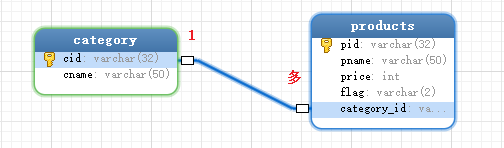
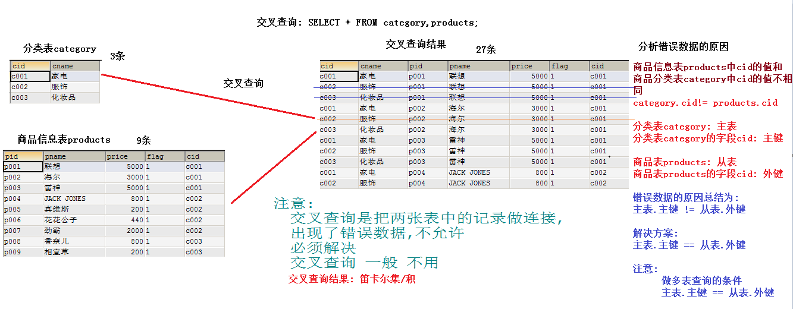
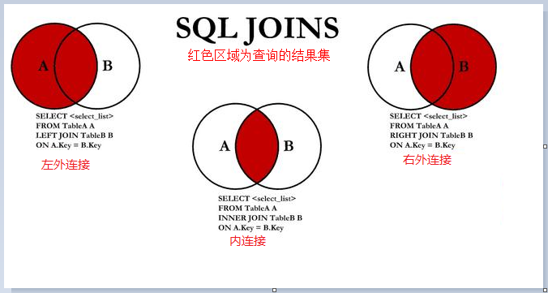
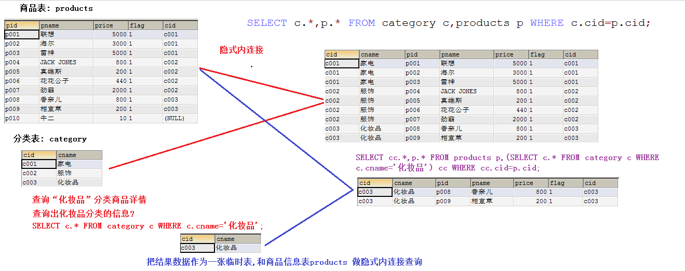

# day4-01MySQL多表查询

# 第一章 多表查询

**提供表结构如下：**



```mysql
# 分类表
CREATE TABLE category (
  cid VARCHAR(32) PRIMARY KEY ,
  cname VARCHAR(50)
);

#商品表
CREATE TABLE products(
  pid VARCHAR(32) PRIMARY KEY ,
  pname VARCHAR(50),
  price INT,
  flag VARCHAR(2), #是否上架标记为：1表示上架、0表示下架
  cid VARCHAR(32),
  CONSTRAINT products_category_fk FOREIGN KEY (cid) REFERENCES category (cid)
);
```

## 1.1 初始化数据

```mysql
#分类
INSERT INTO category(cid,cname) VALUES('c001','家电');
INSERT INTO category(cid,cname) VALUES('c002','服饰');
INSERT INTO category(cid,cname) VALUES('c003','化妆品');
#商品
INSERT INTO products(pid, pname,price,flag,cid) VALUES('p001','联想',5000,'1','c001');
INSERT INTO products(pid, pname,price,flag,cid) VALUES('p002','海尔',3000,'1','c001');
INSERT INTO products(pid, pname,price,flag,cid) VALUES('p003','雷神',5000,'1','c001');

INSERT INTO products (pid, pname,price,flag,cid) VALUES('p004','JACK JONES',800,'1','c002');
INSERT INTO products (pid, pname,price,flag,cid) VALUES('p005','真维斯',200,'1','c002');
INSERT INTO products (pid, pname,price,flag,cid) VALUES('p006','花花公子',440,'1','c002');
INSERT INTO products (pid, pname,price,flag,cid) VALUES('p007','劲霸',2000,'1','c002');

INSERT INTO products (pid, pname,price,flag,cid) VALUES('p008','香奈儿',800,'1','c003');
INSERT INTO products (pid, pname,price,flag,cid) VALUES('p009','相宜本草',200,'1','c003');
```

## 1.2 多表查询

#### 交叉连接查询(开发中不使用-得到的是两个表的乘积) [了解]

* 语法：`select * from A,B;`

```sql
/*
	1.交叉查询
		格式:
			select ... from 表A,表B;
		注意:
			交叉查询是把两张表中的记录做连接,
			出现了错误数据,不允许
			必须解决
			交叉查询 一般 不用
*/
#查询数据
SELECT * FROM category,products;

#统计products表中的记录数
SELECT COUNT(*) FROM products;#9条

#统计category表中的记录数
SELECT COUNT(*) FROM category;#3条

#统计交叉查询后的记录数
SELECT COUNT(*) FROM category,products;#27条
select * from category,products ORDER BY category.cid, pid;
```

* 效果: category表中每条记录,  与 products表中每条记录分别连接



#### 下面通过一张图说明常用的多表查询方式:


#### 内连接查询

* 隐式内连接：`select * from A,B where 条件;`

```java
/*
	内连接: 隐式内连接  看不到连接的英文单词 join
		select ... from 表A,表B where 条件;
		
		条件:
			主表.主键=从表.外键
			主表: 分类表 category
			主表的主键: 分类表 category 的 cid字段
			
			从表: 商品信息表 products
			从表的外键: 商品信息表 products 的 cid字段
			
			category.cid = products.cid
		
	
	#1.查询所有商品的记录,要求显示商品及所属的分类信息
	#2.只查询所有'化妆品'的记录,要求显示商品及所属的分类信息
	#3.查询哪些分类的商品已经上架
	#4.查询每种分类商品的个数
*/
#1.查询所有商品的记录,要求显示商品及所属的分类信息
SELECT category.cname,products.* FROM category,products WHERE category.cid=products.cid;

#可以给表起别名: category表 别名 c,products表 别名p
#sql语句的执行顺序: from ... where ... select
SELECT c.cname,p.* FROM category c,products p WHERE c.cid=p.cid;

#2.只查询所有'化妆品'的记录,要求显示商品及所属的分类信息
SELECT c.cname,p.pname,p.price FROM category c,products p WHERE c.cid=p.cid AND c.cname='化妆品';

#3.查询哪些分类的商品已经上架
SELECT c.cname,p.* FROM category c,products p WHERE c.cid=p.cid AND p.flag='1';


/*
	#4.查询每种分类商品的个数
	分析:
		1.分组: 分类表category中的字段
		2.聚合: 个数 count 
*/
SELECT * FROM category c,products p WHERE c.cid=p.cid;
SELECT c.cname,COUNT(*) FROM category c,products p WHERE c.cid=p.cid GROUP BY c.cname;
SELECT c.cname,COUNT(c.cname) FROM category c,products p WHERE c.cid=p.cid GROUP BY c.cname;
```


* 显示内连接：`select * from A inner join B on 条件;`

```mysql
/*
	内连接: 显式内连接		inner 单词可以省略
	格式:
		select ... from 表A inner join 表B on 条件 where 条件;
		
		条件:
			主表.主键=从表.外键
			主表: 分类表 category
			主表的主键: 分类表 category 的 cid字段
			
			从表: 商品信息表 products
			从表的外键: 商品信息表 products 的 cid字段
			
			category.cid = products.cid
		
	
	#1.查询所有商品的记录,要求显示商品及所属的分类信息
	#2.只查询所有'化妆品'的记录,要求显示商品及所属的分类信息
	#3.查询哪些分类的商品已经上架
	#4.查询每种分类商品的个数
*/
#1.查询所有商品的记录,要求显示商品及所属的分类信息
SELECT * FROM category INNER JOIN products ON category.cid=products.cid;

#给表起别名
SELECT c.cname,p.pid,p.price,p.pname,p.flag FROM category c INNER JOIN products p ON c.cid=p.cid;

#inner 单词可以省略
SELECT c.cname,p.pid,p.price,p.pname,p.flag FROM category c JOIN products p ON c.cid=p.cid;

#2.只查询所有'化妆品'的记录,要求显示商品及所属的分类信息
SELECT c.*,p.* FROM category c INNER JOIN products p ON c.cid=p.cid WHERE c.cname='化妆品';

#3.查询哪些分类的商品已经上架
SELECT c.*,p.* FROM category c INNER JOIN products p ON c.cid=p.cid WHERE p.flag='1';
SELECT * FROM products p INNER JOIN category c ON c.cid=p.cid WHERE p.flag='1';

/*
	#4.查询每种分类商品的个数
	分析:
		1.分组: 分类表category中的字段
		2.聚合: 个数 count 
*/
SELECT c.cid,COUNT(*) FROM category c JOIN products p ON c.cid=p.cid GROUP BY c.cid;
SELECT c.cid,COUNT(p.pid) FROM category c JOIN products p ON c.cid=p.cid GROUP BY c.cid;

SELECT c.cname,COUNT(*) FROM category c JOIN products p ON c.cid=p.cid GROUP BY c.cname;
```

#### 外连接查询

* 左外连接：left outer join
  * `select * from A left outer join B on 条件;`
* 右外连接：right outer join
  * `select * from A right outer join B on 条件;`

```mysql
/*
	外连接			outer 单词可以省略
	1.左外连接
		select ... from 表A left outer join 表B on 条件 where 其它条件
		
		
	2.右外连接
		select ... from 表A right outer join 表B on 条件 where 其它条件
		
		条件:
			主表.主键=从表.外键
			主表: 分类表 category
			主表的主键: 分类表 category 的 cid字段
			
			从表: 商品信息表 products
			从表的外键: 商品信息表 products 的 cid字段
			
			category.cid = products.cid
		
		
	#1.查询所有商品的记录,要求显示商品及所属的分类信息
	#2.只查询所有'化妆品'的记录,要求显示商品及所属的分类信息
	#3.查询哪些分类的商品已经上架
	#4.查询每种分类商品的个数
*/
#1.查询所有商品的记录,要求显示商品及所属的分类信息
SELECT c.*,p.* FROM category c LEFT OUTER JOIN products p ON c.cid=p.cid;
SELECT c.*,p.* FROM category c LEFT JOIN products p ON c.cid=p.cid;
/*
	注意:
		对于左外连接而言,left左侧表中的所有记录,不管是否有对应的右侧表的信息,必须全部显示
		对于内连接而言,必须保证主表和从表都有对应的数据才会显示
*/
#商品表products中添加一条记录,该记录没有cid
SELECT p.*,c.* FROM products p LEFT JOIN category c ON c.cid=p.cid;

SELECT p.*,c.* FROM products p LEFT JOIN category c ON c.cid=p.cid WHERE c.cid IS NOT NULL;

#隐式内连接
SELECT p.*,c.* FROM products p,category c WHERE c.cid=p.cid;

#显式内连接
SELECT p.*,c.* FROM products p INNER JOIN category c WHERE c.cid=p.cid;

#2.只查询所有'化妆品'的记录,要求显示商品及所属的分类信息
SELECT c.*,p.* FROM category c LEFT OUTER JOIN products p ON c.cid=p.cid WHERE c.cname='化妆品';

#3.查询哪些分类的商品已经上架
SELECT c.*,p.* FROM category c LEFT OUTER JOIN products p ON c.cid=p.cid WHERE p.flag='1';

/*
	#4.查询每种分类商品的个数
	分析:
		1.分组: 分类表category中的字段
		2.聚合: 个数 count 
*/
SELECT c.cname,COUNT(*) FROM category c LEFT JOIN products p ON c.cid=p.cid GROUP BY c.cname;
```


## 1.3 子查询

**子查询**：一条select语句结果作为另一条select语法一部分（查询条件，查询结果，表等）。
**语法**：`select ....查询字段 ... from ... 表.. where ... 查询条件`




**子查询作为条件**

```mysql
/*
	子查询：
		子查询：一条select语句结果作为另一条select语法一部分（查询条件，查询结果，表等）。
			语法：select ....查询字段 ... from ... 表.. where ... 查询条件
	#一.查询“化妆品”分类商品详情
	#二.查询“化妆品”分类上架商品详情
	#三.查询“化妆品”或者“家电”两个分类上架商品详情
	
*/
#一.查询“化妆品”分类商品详情
/*
	以下查询,虽然有结果,但是该sql语句存在问题
		1.题目给出的是分类的名称,而我们使用的是分类的cid,与题目要求不符
		2.相当于把cid作为了已知条件,cid就写死了,以后cid可能会发生变化
*/
SELECT * FROM products WHERE cid='c003';
#1.查询出'化妆品'分类的cid的值
SELECT cid FROM category WHERE cname='化妆品';
#2.把步骤1中查询出来的cid的值作为条件
SELECT * FROM products WHERE cid=(SELECT cid FROM category WHERE cname='化妆品');

#二.查询“化妆品”分类上架商品详情
#1.查询出'化妆品'分类的cid的值
SELECT cid FROM category WHERE cname='化妆品';
#2.把步骤1中查询出来的cid的值作为条件
SELECT * FROM products WHERE cid=(SELECT cid FROM category WHERE cname='化妆品') AND flag='1';

#三.查询“化妆品”或者“家电”两个分类上架商品详情
#1.查询出'化妆品'或者'家电'分类的cid的值
SELECT cid FROM category WHERE cname IN('化妆品','家电');

#2.把步骤1中查询出来的cid的值作为条件
SELECT * FROM products WHERE cid IN(SELECT cid FROM category WHERE cname IN('化妆品','家电')) AND flag='1';

```


**子查询作为表格**

```mysql
/*
	子查询：			
			一条select语句结果作为另一条select语法一部分（查询条件，查询结果，表等）。
			语法：select ....查询字段 ... from ... 表.. where ... 查询条件
			
	#一.查询“化妆品”分类商品详情
	#二.查询“化妆品”和“家电”两个分类上架商品详情
*/

#查询分类信息
SELECT * FROM category;

#查询商品信息
SELECT * FROM products;

#隐式内连接查询
SELECT c.*,p.* FROM category c,products p WHERE c.cid=p.cid;

#1.查询出化妆品分类的信息
SELECT c.* FROM category c WHERE c.cname='化妆品';
#2.把步骤1中的结果作为一张表和商品表products进行隐式内连接查询
SELECT cc.*,p.* FROM products p,(SELECT c.* FROM category c WHERE c.cname='化妆品') cc WHERE cc.cid=p.cid;

#二.查询“化妆品”和“家电”两个分类上架商品详情
#1.查询出化妆品和家电分类的信息
SELECT c.* FROM category c WHERE c.cname IN('化妆品','家电');
#2.把步骤1中的结果作为一张表和商品表products进行隐式内连接查询
SELECT cc.*,p.* FROM products p,(SELECT c.* FROM category c WHERE c.cname IN('化妆品','家电')) cc WHERE cc.cid=p.cid AND p.flag='1';

```


