# day9-00AI训练营2.0-RAG全流程解析

### 1、为什么需要RAG？
- 大模型的知识具有滞后性
- 大模型有幻觉
- 缺乏专业领域知识

### 2、以上问题如何解决？
针对上述大模型存在的数据滞后性、幻觉、缺乏领域知识等问题，其根源在于模型没有对应的知识可以参考。
那么，是否可以换个思路:每次提问时，先从外部知识库中检索出相关内容，连同用户问题一起提供给模型，并要求其基于我们提供的知识来回答。
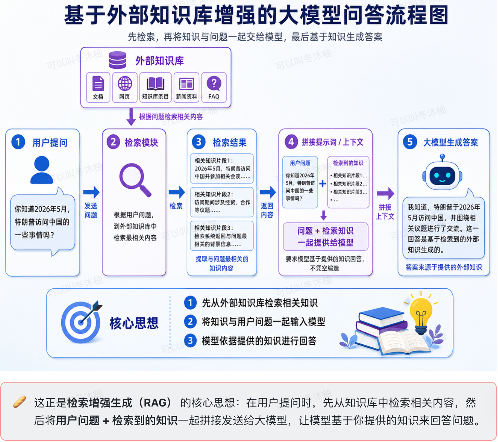

### 3、RAG是什么？（RAG的本质就是外挂）
**RAG(Retrieval-Augmented Generation，检索增强生成)** 是当前最热门的大模型应用技术。它通过从外部知识库检索相关信息，然后将这些信息作为上下文提供给大模型，让AI基于真实知识回答问题。

**RAG的作用：把查到的知识塞进Prompt，让大模型基于资料回答，减少幻觉、可追溯。**

### 4、RAG的详细工作流程（2个阶段）
#### 4.1、索引构建阶段（知识库构建）
准备数据 -> 数据加载 -> 文本拆分 -> 向量化 -> 向量存储。

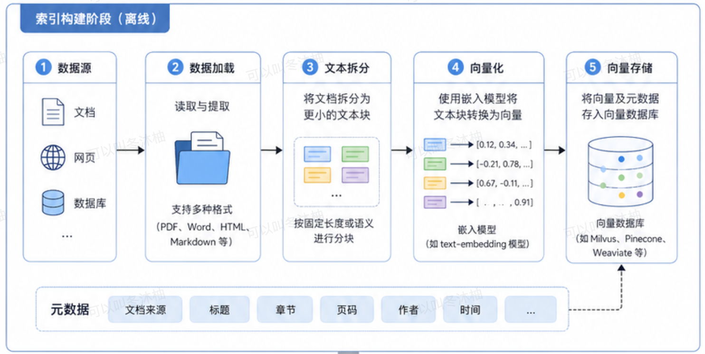

##### 4.1.1、准备数据
构建知识库需预先具备原始数据，常见的数据类型如下：
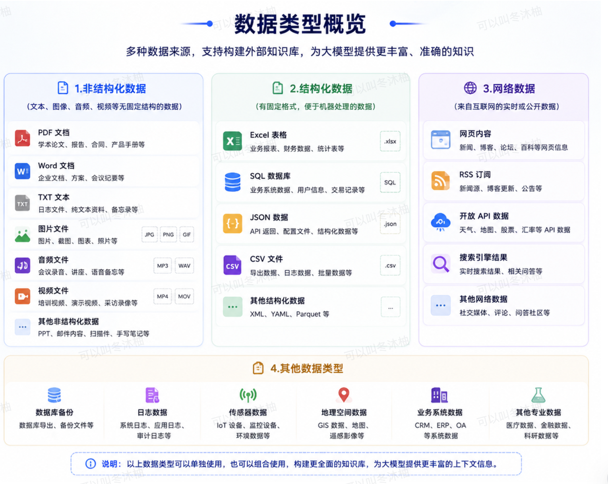

##### 4.1.2、数据加载
不同的数据类型对应不同的LangChain文档加载器（Loader）：
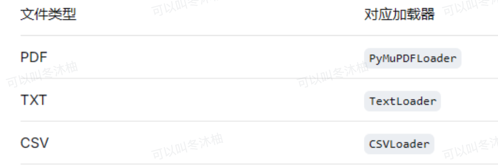

大多数文档类型均有对应的Loader支持。若无专用Loader也可以使用Python原生文件读取方式替代。

##### 4.1.3、文本拆分
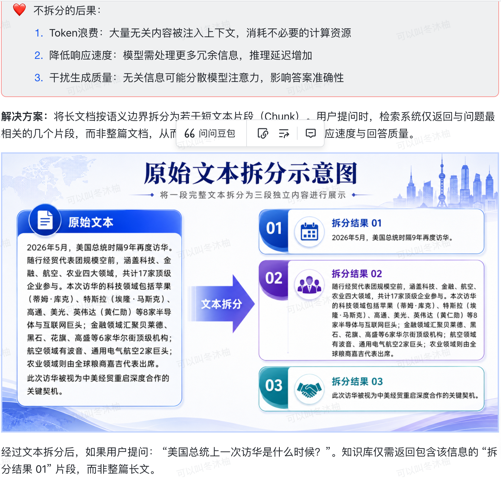
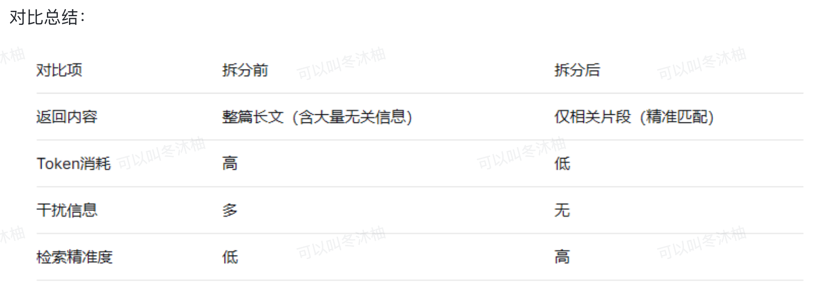

##### 4.1.4、向量化
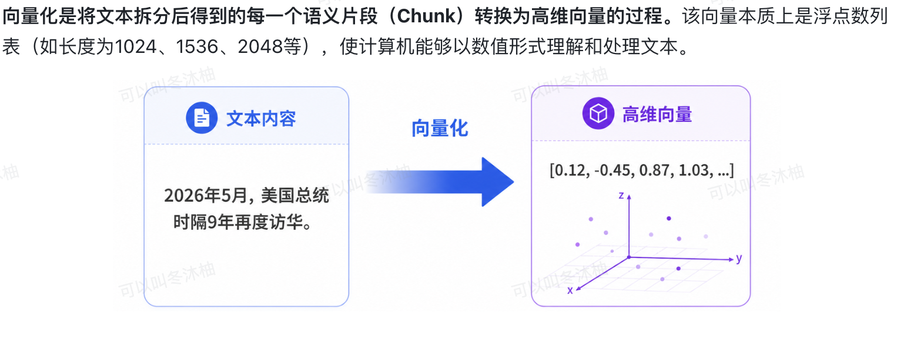
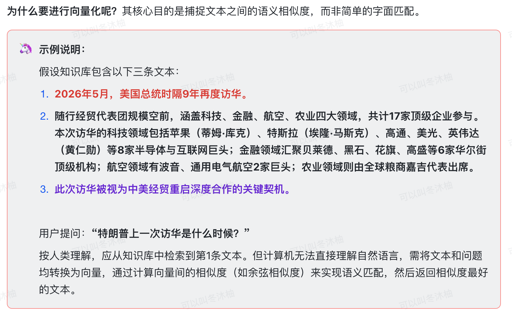
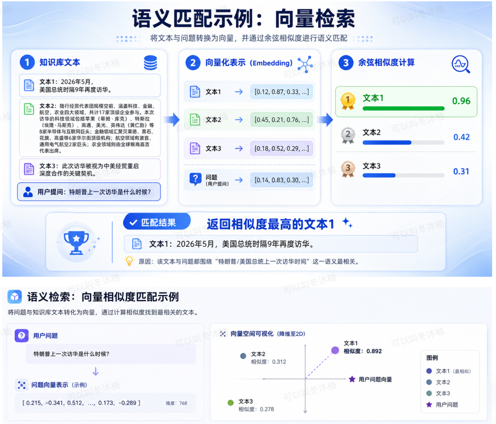
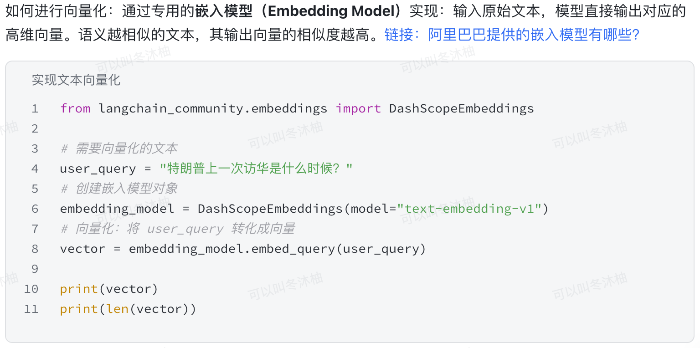

##### 4.1.5、向量存储
将向量化的数值向量与对应的原始文本片段，以键值对的形式存储于向量数据库中。形式如下：
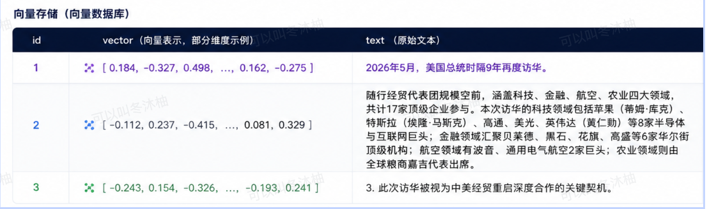

完成向量存储后，知识库构建完毕，可供后续检索使用。

#### 4.2、检索增强生成阶段
检索增强生成阶段（RAG 查询与生成）：用户问题 → 问题向量化 → 向量检索（召回相关知识）→ 构建提示词 → 大模型生成答案

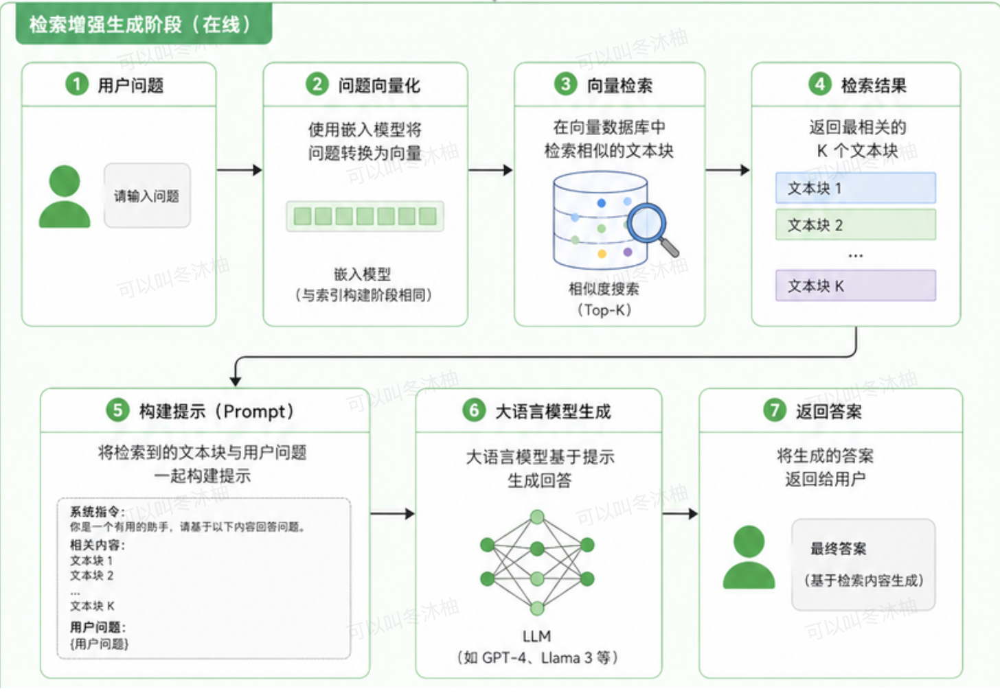

##### 4.2.1、去知识库检索知识（检索内容）
用户提问时，系统首先将用户问题通过**嵌入模型（Embedding Model）**转换为向量，然后在**向量数据库**中检索与该问题向量最相似的文本片段，从而召回与问题语义最相关的知识。
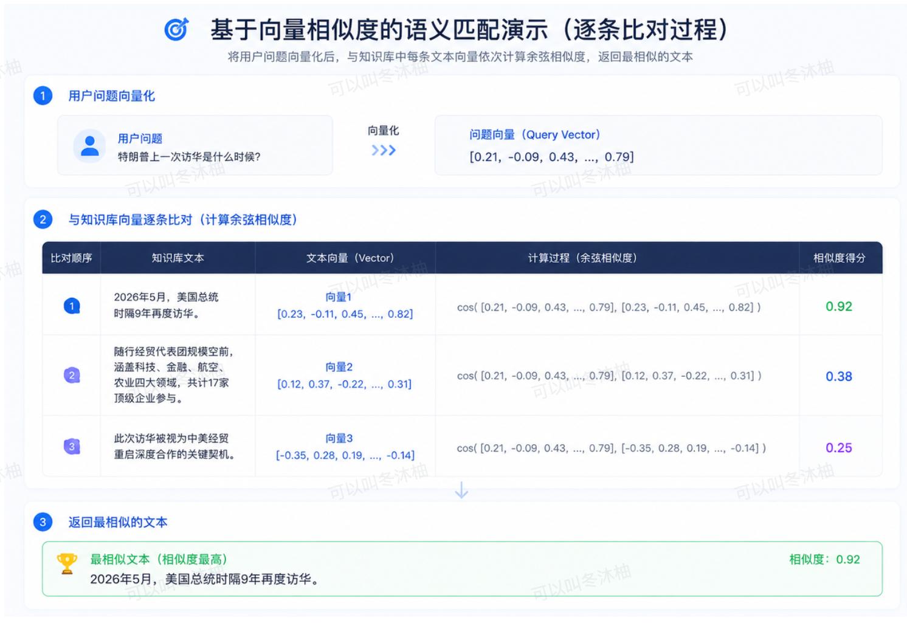

##### 4.2.2、构建提示词
将**系统提示词（System Prompt）**、**用户问题**、**检索召回内容**按固定格式拼接，作为大模型的输入。
```python
[System Prompt]
你是一个智能回答助手，请你根据参考内容回答用户问题。

用户提问：{user_query}

参考内容：
1. {召回的最相似文本1}
2. {召回的次相似文本2}
...
```

##### 4.2.3、调用大模型
将拼接完成的提示词直接发送给大语言模型，模型基于提示词中提供的参考内容生成回答。

### 5、RAG总结
核心思想：**先检索，再生成**—— 让模型基于外部知识回答，而非凭记忆编造。

**两大阶段**
| 阶段 | 核心任务 | 关键步骤 |
| -- | -- | -- |
| 索引构建 | 准备知识库 | 数据加载 → 文本拆分 → 向量化 → 向量存储 |
| 检索增强生成 | 查询与回答 | 问题向量化 → 向量检索 → 构建提示词 → 模型生成 |

**RAG 解决的三大问题**
| 问题 | RAG 解决方案 |
| -- | -- |
| 数据滞后性 | 实时检索最新外部知识 |
| 模型幻觉 | 提供真实文档约束生成 |
| 缺乏领域知识 | 接入私有知识库 |

**一句话总结：RAG = 外部知识库 + 向量检索 + 大模型生成，让回答有据可依。**


