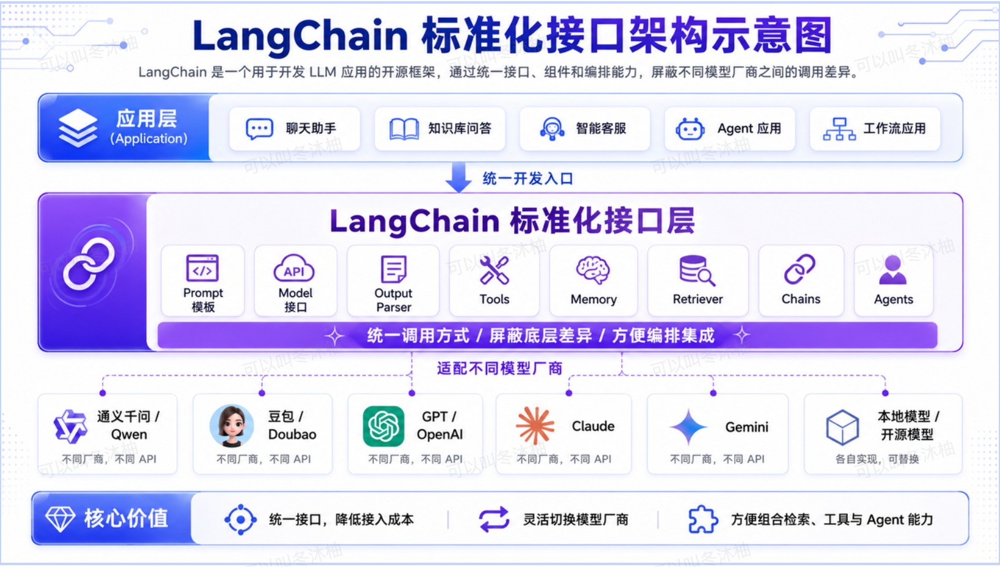
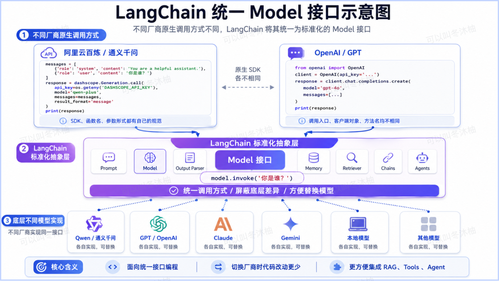
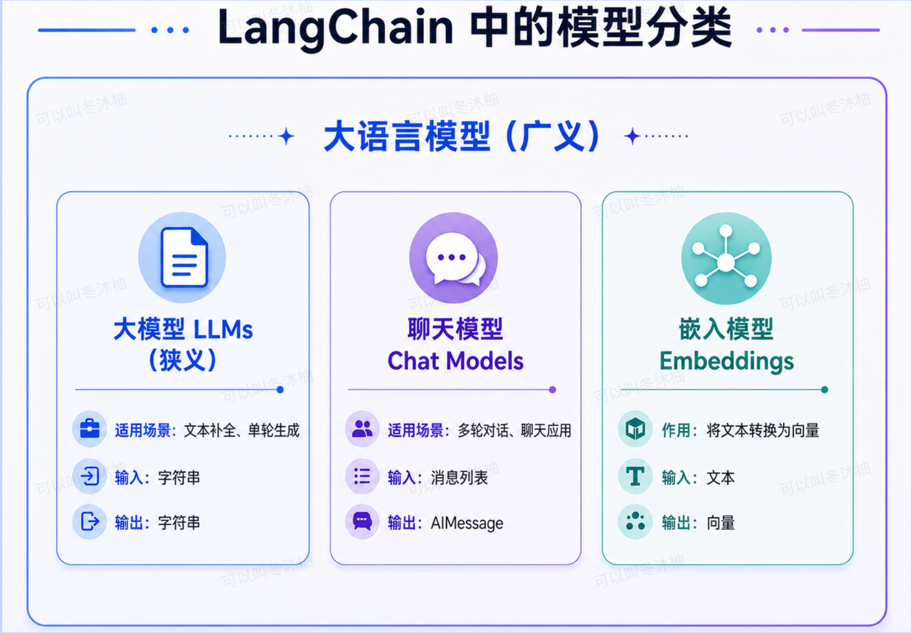
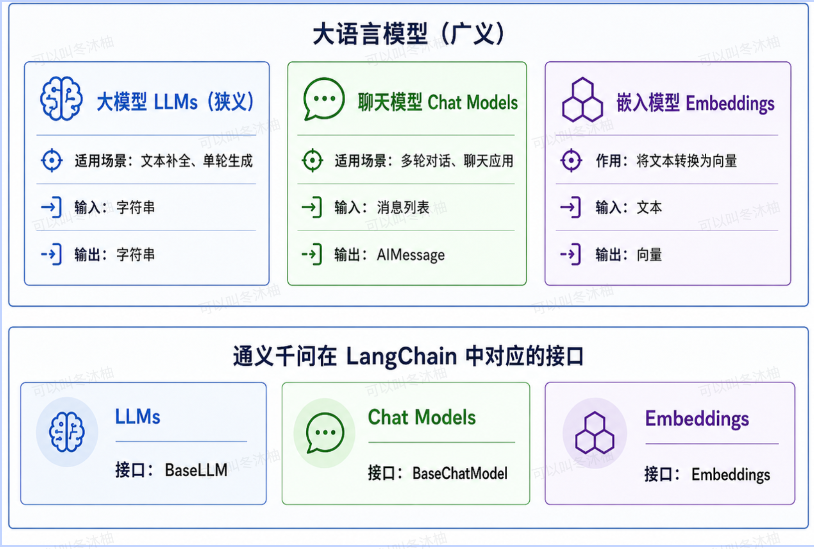
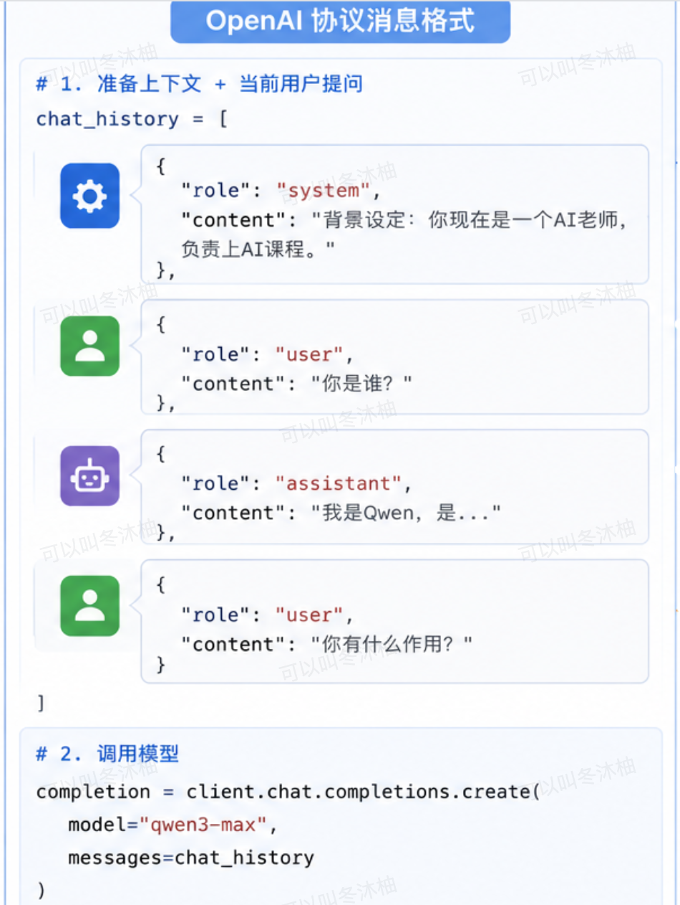
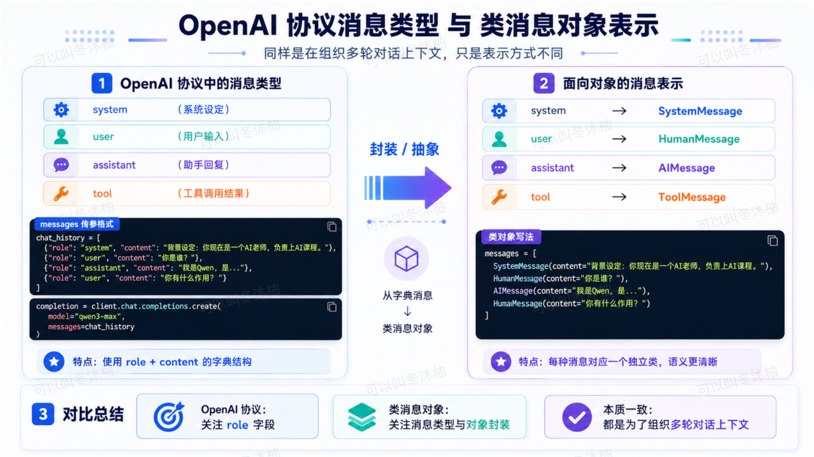
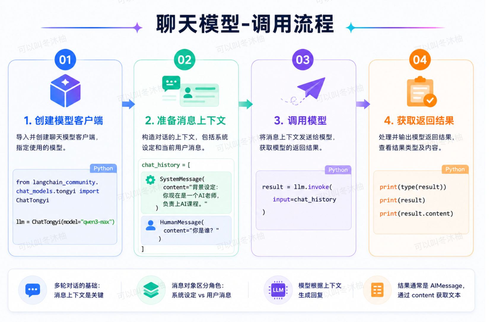
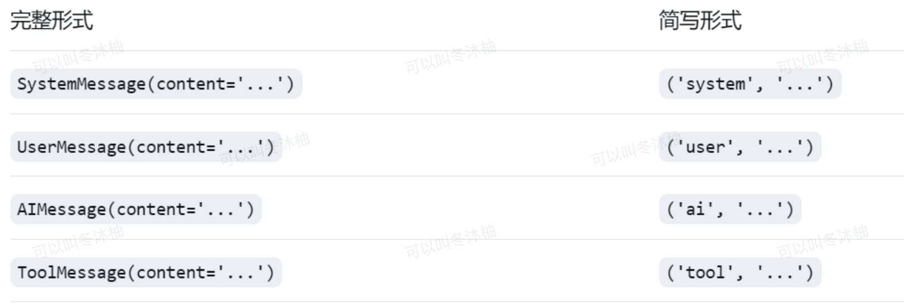
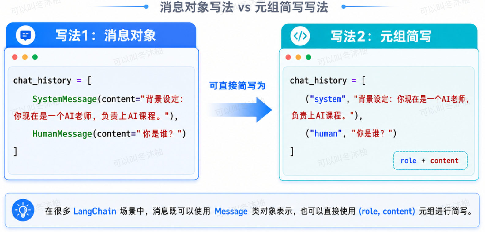

# day11-00AI训练营2.0-LangChain快速入门

### 1. Langchain 是什么？

LangChain 是一个用于开发基于大语言模型 (LLM) 应用程序的**开源框架**。它提供了一套**标准化的接口、组件和编排工具**，旨在简化将大模型与外部数据源、工具及业务流程进行集成的复杂度。

#### 1.1、Langchain架构示意图


#### 1.2、Langchain统一Model接口的示意图


### 2. 包安装

在使用 LangChain 框架之前，需先安装相应的 Python 包。以下是各核心包的功能说明：

```bash
pip install langchain langchain-community dashscope -i https://pypi.tuna.tsinghua.edu.cn/simple
```

1. **langchain**：LangChain 核心包，包含 LangChain 框架的核心接口规范、抽象基类、链式调用机制、提示词模板、记忆管理、智能体等核心组件。该包主要定义接口规范，具体实现由其他包提供。
2. **langchain-community**：社区贡献包，提供大量第三方模型、向量数据库、文档加载器、文本分割器等组件的具体实现。其中包括对多家大模型厂商的集成适配（如字节跳动 Coze、阿里通义千问、智谱 ChatGLM 等）。该包由开源社区维护，持续集成各类服务商的接口封装。
3. **dashscope**：阿里云百炼平台官方 SDK，用于连接阿里云百炼平台（DashScope）的模型服务。

### 3、LangChain的模型分类
站在阿里云百炼平台的角度，其提供的模型分类虽多，但从LangChain对操作这些模型的API分类层面来看，可分为三类:大模型(LLMs，狭义)、聊天模型与嵌入模型。


> 📌 通义千问分别为这三类模型提供了对应的接口与具体实现类：
> 1. 大模型对应 `BaseLLM` 接口。
> 2. 聊天模型对应 `BaseChatModel` 接口。
> 3. 嵌入模型对应 `Embeddings` 接口。

开发者在实际调用时，可根据任务类型选择相应的接口与实现类，从而统一调用不同模型。


#### 3.1、Langchain对三类接口的实现类
在LangChain框架中，为统一调用阿里云百炼平台的不同模型，针对大模型（LLMs）、聊天模型（Chat Models）与嵌入模型（Embeddings）分别定义了抽象接口，并提供对应的具体实现类。

大模型（LLMs）：对应 BaseLLM 接口，其实现类为 Tongyi。该类主要用于传统的文本补全任务，接收字符串输入并返回字符串输出。

聊天模型（Chat Models）：对应 BaseChatModel 接口，其实现类为 ChatTongyi。该类支持多轮对话上下文管理，以消息列表（如 SystemMessage、HumanMessage、AIMessage）作为输入与输出，适用于对话式AI应用。

嵌入模型（Embeddings）：对应 Embeddings 接口，其实现类为 DashScopeEmbeddings。该类负责将文本转换为向量表示，常用于语义搜索、聚类与检索增强生成（RAG）等场景。

```python
from langchain_community.embeddings import DashScopeEmbeddings
from langchain_community.llms.tongyi import Tongyi
from langchain_community.chat_models import ChatTongyi

# 源码如下：
class Tongyi(BaseLLM): ...
class ChatTongyi(BaseChatModel): ...
class DashScopeEmbeddings(BaseModel, Embeddings): ...
```

### 4、快速入门和模型对话

#### 4.1、和大模型（狭义）对话

#### 4.2、和聊天模型对话

##### 4.2.1 消息类型有哪些

在讲解 OpenAI 协议时，我们介绍过五种消息类型，分别为：`system`（系统设定）、`assistant`（助手回复）、`user`（用户输入）、`tool`（工具调用结果）、~~`function`（函数调用）~~。这些消息类型共同用于构建多轮对话的上下文结构。

消息上下文按照以下格式传递给模型：


在前述基于 OpenAI 协议的消息传递方式中，消息以字典格式组织。但在 LangChain 框架中，不再采用字典形式，而是为每种消息类型定义了相应的类。具体对应关系如下：

- `system` 类型对应 `SystemMessage` 类
- `user` 类型对应 `HumanMessage` 类
- `assistant` 类型对应 `AIMessage` 类
- `tool` 类型对应 `ToolMessage` 类

通过将每条消息实例化为对应的类对象，便于在复杂对话流程中进行消息的构建、校验与管理。

```python
from langchain_core.messages import SystemMessage, HumanMessage, AIMessage, ToolMessage
```


##### 4.2.2、聊天模型调用流程


##### 4.2.3、消息类型简写



#### 4.3、嵌入式模型