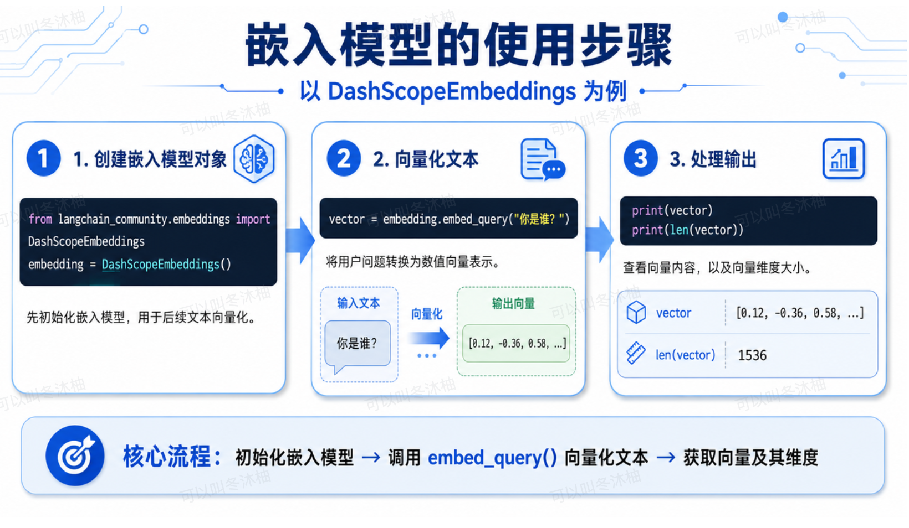
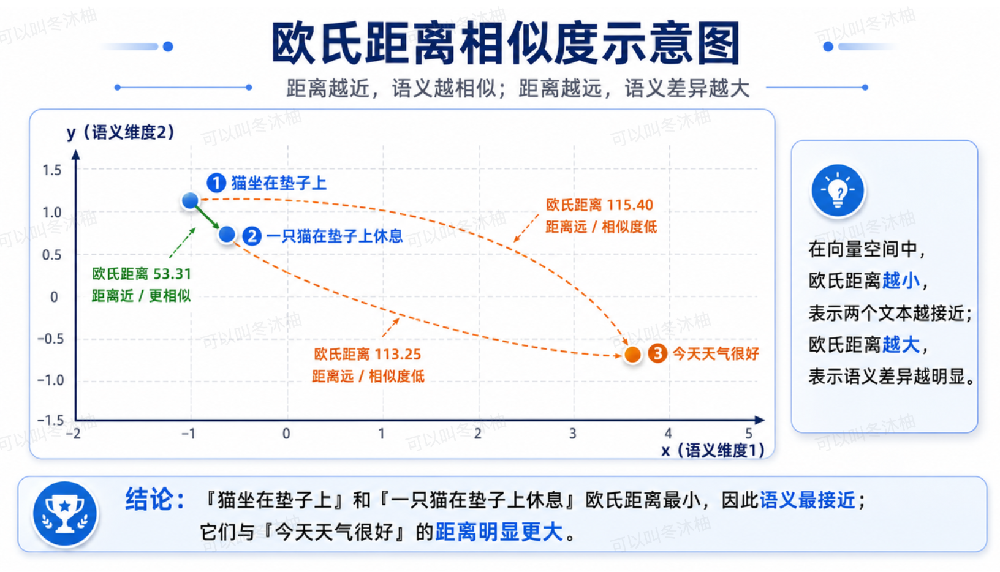
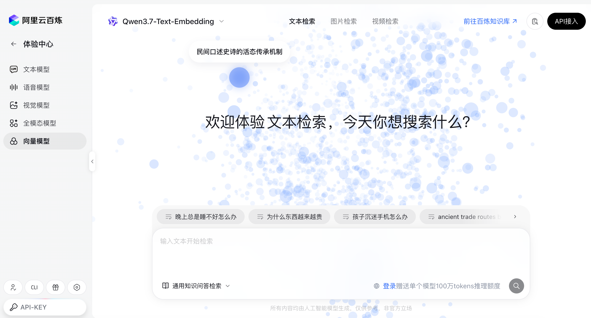
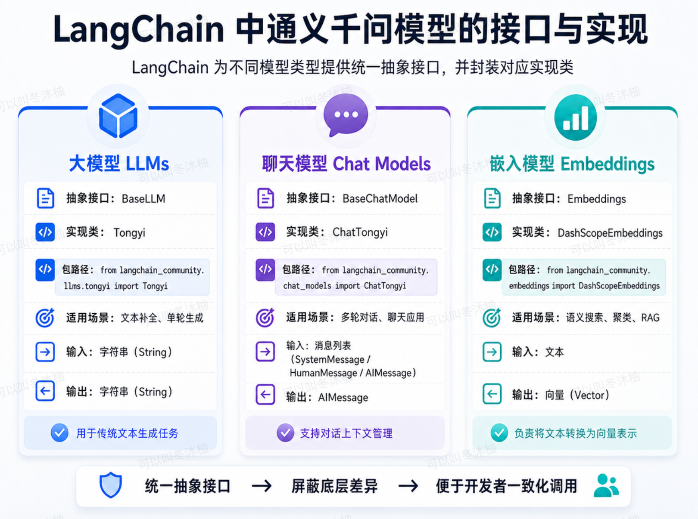

# day11-00AI训练营2.0-LangChain快速入门

### 1. Langchain 是什么？

LangChain 是一个用于开发基于大语言模型 (LLM) 应用程序的**开源框架**。它提供了一套**标准化的接口、组件和编排工具**，旨在简化将大模型与外部数据源、工具及业务流程进行集成的复杂度。

#### 1.1、Langchain架构示意图


#### 1.2、Langchain统一Model接口的示意图


### 2. 包安装

在使用 LangChain 框架之前，需先安装相应的 Python 包。以下是各核心包的功能说明：

```bash
pip install langchain langchain-community dashscope -i https://pypi.tuna.tsinghua.edu.cn/simple
```

1. **langchain**：LangChain 核心包，包含 LangChain 框架的核心接口规范、抽象基类、链式调用机制、提示词模板、记忆管理、智能体等核心组件。该包主要定义接口规范，具体实现由其他包提供。
2. **langchain-community**：社区贡献包，提供大量第三方模型、向量数据库、文档加载器、文本分割器等组件的具体实现。其中包括对多家大模型厂商的集成适配（如字节跳动 Coze、阿里通义千问、智谱 ChatGLM 等）。该包由开源社区维护，持续集成各类服务商的接口封装。
3. **dashscope**：阿里云百炼平台官方 SDK，用于连接阿里云百炼平台（DashScope）的模型服务。

### 3、LangChain的模型分类
站在阿里云百炼平台的角度，其提供的模型分类虽多，但从LangChain对操作这些模型的API分类层面来看，可分为三类:大模型(LLMs，狭义)、聊天模型与嵌入模型。


> 📌 通义千问分别为这三类模型提供了对应的接口与具体实现类：
> 1. 大模型对应 `BaseLLM` 接口。
> 2. 聊天模型对应 `BaseChatModel` 接口。
> 3. 嵌入模型对应 `Embeddings` 接口。

开发者在实际调用时，可根据任务类型选择相应的接口与实现类，从而统一调用不同模型。


#### 3.1、Langchain对三类接口的实现类
在LangChain框架中，为统一调用阿里云百炼平台的不同模型，针对大模型（LLMs）、聊天模型（Chat Models）与嵌入模型（Embeddings）分别定义了抽象接口，并提供对应的具体实现类。

大模型（LLMs）：对应 BaseLLM 接口，其实现类为 Tongyi。该类主要用于传统的文本补全任务，接收字符串输入并返回字符串输出。

聊天模型（Chat Models）：对应 BaseChatModel 接口，其实现类为 ChatTongyi。该类支持多轮对话上下文管理，以消息列表（如 SystemMessage、HumanMessage、AIMessage）作为输入与输出，适用于对话式AI应用。

嵌入模型（Embeddings）：对应 Embeddings 接口，其实现类为 DashScopeEmbeddings。该类负责将文本转换为向量表示，常用于语义搜索、聚类与检索增强生成（RAG）等场景。

```python
from langchain_community.embeddings import DashScopeEmbeddings
from langchain_community.llms.tongyi import Tongyi
from langchain_community.chat_models import ChatTongyi

# 源码如下：
class Tongyi(BaseLLM): ...
class ChatTongyi(BaseChatModel): ...
class DashScopeEmbeddings(BaseModel, Embeddings): ...
```

### 4、快速入门和模型对话

#### 4.1、和大模型（狭义）对话

#### 4.2、和聊天模型对话

##### 4.2.1 消息类型有哪些

在讲解 OpenAI 协议时，我们介绍过五种消息类型，分别为：`system`（系统设定）、`assistant`（助手回复）、`user`（用户输入）、`tool`（工具调用结果）、~~`function`（函数调用）~~。这些消息类型共同用于构建多轮对话的上下文结构。

消息上下文按照以下格式传递给模型：


在前述基于 OpenAI 协议的消息传递方式中，消息以字典格式组织。但在 LangChain 框架中，不再采用字典形式，而是为每种消息类型定义了相应的类。具体对应关系如下：

- `system` 类型对应 `SystemMessage` 类
- `user` 类型对应 `HumanMessage` 类
- `assistant` 类型对应 `AIMessage` 类
- `tool` 类型对应 `ToolMessage` 类

通过将每条消息实例化为对应的类对象，便于在复杂对话流程中进行消息的构建、校验与管理。

```python
from langchain_core.messages import SystemMessage, HumanMessage, AIMessage, ToolMessage
```


##### 4.2.2、聊天模型调用流程


##### 4.2.3、消息类型简写


##### 4.2.4、基于聊天模型实现多论对话
```python
from langchain_community.chat_models import ChatTongyi

class MultiTurnChat:
    def __init__(self,model:str,system_prompt:str = None) -> None:
        self.llm = ChatTongyi(
            model = model,
            streaming=True
        )
        self.chat_history = []
        if system_prompt:
            self.chat_history.append(('system',system_prompt))

    def add_user_message(self,content:str) -> None:
        self.chat_history.append(("human",content))

    def add_ai_message(self,content:str) -> None:
        self.chat_history.append(("ai",content))

    def send(self, user_message:str):
        # 1.添加用户消息到历史
        self.add_user_message(user_message)
        # 2.直接使用history 调用模型进行流式输出
        stream = self.llm.stream(input=self.chat_history)
        # 3.收集完整并逐块返回
        full_reply=""
        for chunk in stream:
            if chunk.content:
                full_reply += chunk.content
                yield chunk.content
        # 4.添加模型的完整回复到历史
        self.add_ai_message(full_reply)


if __name__ == '__main__':
    #1.配置参数
    MODEL = "deepseek-v4-pro-0813"
    SYSTEM_MESSAGE = "背景设定：你现在是一个AI老师，负责AI课程"
    #2.创建多论对话对象
    chat = MultiTurnChat(
        model=MODEL,
        system_prompt=SYSTEM_MESSAGE
    )
    print("多论对话已启动，输入内容按回车发送，输入'exit'或'quit'退出程序")
    #循环接受客户输入并回答
    while True:
        #获取用户输入
        user_input = input("human:")
        #退出条件判断
        if user_input.strip() in ('exit','quit'):
            print("对话结束,拜拜")
            break
        if not user_input.strip():
            print("请勿输入空白字符")
            continue
        #调用模型并回复
        print("AI老师:",end='',flush=True)
        for chunk in chat.send(user_input):
            print(chunk,end='',flush=True)
        print()
```

##### 4.2.5、消息类型和二元组区别
采用二元组简写方式后，对话历史可更直观地表达为列表形式，例如：
```Python
python
chat_history = [
    ('system', '你现在是一个AI老师。'),
    ('user', '你是谁？'),
    ('ai', '我是Qwen。')
]
```
LangChain内部会自动将二元组转换为对应的消息类对象，在保持功能完整性的同时，降低了代码冗余度。

此外，在实际开发中，**二元组形式的消息可先使用 {} 占位符进行占位**，后续再通过变量替换动态填充内容。这一技术细节将在后续课程中进一步学习。
```Python
# 使用占位符定义消息模板
message_template = [('user', '请解释一下 {question} 的概念')]

# 调用模型：{question} -> langchain
```

#### 4.3、嵌入式模型
嵌入模型（Embeddings）的核心职责是将文本转换为向量表示。在这一向量空间中，语义越相近的文本，其对应向量的相似度越高。

这一特性使得嵌入模型广泛应用于以下场景：
- **语义搜索**：根据查询文本的向量，检索语义最相关的文档
- **文本聚类**：将语义相似的文本自动归入同一类别
- **检索增强生成（RAG）**：从知识库中检索与用户问题最相关的内容，作为大模型生成回答的上下文

向量相似度的常用度量方式包括余弦相似度（Cosine Similarity）与欧氏距离（Euclidean Distance），相似度越高，表示两条文本在语义层面越接近。

##### 4.3.1、嵌入模型的使用步骤

代码实现如下：

```python
from langchain_community.embeddings import DashScopeEmbeddings

# 1. 创建嵌入模型对象
embedding = DashScopeEmbeddings()

# 2. 向量化
vector = embedding.embed_query("你是谁？")

# 3. 处理输出
print(vector)
print(len(vector))
```

##### 4.3.2、相似度测试
```Python
from langchain_community.embeddings import DashScopeEmbeddings
import numpy as np


def euclidean_distance(a, b):
    """计算欧氏距离"""
    return np.linalg.norm(np.array(a) - np.array(b))


if __name__ == '__main__':
    # 准备三个测试文本：前两个语义相近，第三个语义无关
    texts = ["猫坐在垫子上", "一只猫在垫子上休息", "今天天气很好"]
    vectors = DashScopeEmbeddings().embed_documents(texts)

    # 计算欧氏距离并观察结果
    print(f"'{texts[0]}' 与 '{texts[1]}' 的欧氏距离: {euclidean_distance(vectors[0], vectors[1])}")
    print(f"'{texts[0]}' 与 '{texts[2]}' 的欧氏距离: {euclidean_distance(vectors[0], vectors[2])}")
    print(f"'{texts[1]}' 与 '{texts[2]}' 的欧氏距离: {euclidean_distance(vectors[1], vectors[2])}")

"""
'猫坐在垫子上' 与 '一只猫在垫子上休息' 的欧氏距离: 53.30557172891227
'猫坐在垫子上' 与 '今天天气很好' 的欧氏距离: 115.3968429781511
'一只猫在垫子上休息' 与 '今天天气很好' 的欧氏距离: 113.25200288012354
"""
```



##### 4.3.3、阿里云百炼-相似度案例
[阿里云百炼-相似度案例](https://bailian.console.aliyun.com/cn-beijing/model/experience/embedding/embedding-model)



### 5、总结

